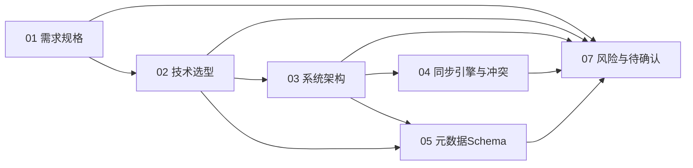

# 00 - 总览与阅读指南

> **TL;DR**：本项目是**跨平台电子书进度同步阅读应用**（正式名 SyncReader）：免费、无容量限制，同步完全由用户自己的 WebDAV 存储承载（坚果云为第一目标），软件本身不提供任何云服务、零收费、零遥测。本文档集是设计基线：九份文档构成完整规范（§2），六大关键决策见 §3，产品能力见 §4，当前状态见 §5。

---

## 1. 一句话定位

用户在 Android（手机/平板）与 Windows 桌面端上使用同一份书库、阅读进度实时一致；同步走用户自己的坚果云（WebDAV）或任意兼容 WebDAV 的网盘，软件本身零云服务、零收费。

## 2. 文档地图

| 文档 | 内容 | 读者 |
| --- | --- | --- |
| [01-需求规格说明](./01-需求规格说明.md) | FR/NFR 逐条编号 + 验收标准 + 平台优先级 + 用户流程 | 全体 |
| [02-技术选型](./02-技术选型.md) | 六大决策 + 工程配套选型，每项含 ≥2 候选对比表与结论/风险 | 全体 |
| [03-系统架构设计](./03-系统架构设计.md) | 总体架构、模块与目录划分、核心接口、数据流、平台适配 | 客户端开发 |
| [04-同步引擎与冲突解决](./04-同步引擎与冲突解决.md) | 同步状态机、diff 矩阵、冲突合并算法、删除语义、流量优化与估算 | 同步/客户端 |
| [05-元数据Schema与云端目录布局](./05-元数据Schema与云端目录布局.md) | 云端目录、meta JSON 字段级 schema、locator 定义、SQLite DDL、版本迁移 | 同步/客户端 |
| [07-风险与待确认问题](./07-风险与待确认问题.md) | 默认假设（A）、待确认问题（Q）、风险（R）与决策变更影响图 | 全体 |
| [08-开发环境搭建](./08-开发环境搭建.md) | Windows/Android 构建链、工具链、镜像与踩坑规避 | 开发 |
| [09-发布与分发](./09-发布与分发.md) | 版本号策略、签名纪律、打包脚本、发布流程、第三方声明 | 发布 |
| [10-界面重设计方案](./10-界面重设计方案.md) | 界面设计规范：设计系统、页面方案、交互约定 | 设计/前端 |

依赖关系：

## 3. 六大决策速览（详见 02）

| 决策点 | 结论 | 一句话理由 |
| --- | --- | --- |
| D1 UI 框架 | **Flutter** | P0/P1 六端官方支持；自绘引擎天然胜任文本测量分页；阅读生态最全 |
| D2 格式渲染 | txt/md/epub 纯 Flutter 自渲染（epub_pro 解析、flutter_markdown_plus、自研分页）；pdf 用 **pdfrx** | 不依赖 WebView（官方 webview_flutter 不支持 Windows）；统一主题与进度定位 |
| D3 本地存储 | **drift（SQLite）** 管元数据/进度/同步状态 + 文件系统存正文 | 书库是多条件关系查询场景；六端无坑、可单测 |
| D4 元数据 | 每书一个 JSON（`meta/{bookId}.json`）+ `schemaVersion`；云端目录布局对坚果云与通用 WebDAV 一致 | 单书级增量、冲突面最小、WebDAV 友好、可人工修复 |
| D5 冲突策略 | **LWW（rev → updatedAt → deviceId）+ tombstone**；totalSeconds 求和特例 | 心智简单、可预期；rev 单调性免疫时钟回拨 |
| D6 工程配套 | Riverpod / go_router / dio / drift / flutter_secure_storage / ulid / crypto | 均为活跃维护、跨端覆盖的社区标准件 |

> 同步后端只有一种：**WebDAV**（坚果云为第一目标，架构上兼容任意 WebDAV 网盘）。客户端通过 `BackendAdapter` 抽象隔离传输细节，冲突裁决始终在客户端。

## 4. 能力总览

### 书库

- 网格 / 列表两种视图：书卡带封面、状态胶囊与进度条；状态 chip × 分组下拉两层筛选（取交集 + 分面计数）；搜索、排序、视图切换
- 导入：单本导入与批量导入（选文件夹 → 递归扫描 → 清单确认 → 导入，含「同时上传到云端」开关与完成汇总）
- 导入流水线：流式哈希 → 库内查重 → 生成 ULID → 解析元数据 → 封面落盘 → 复制正文 → upsert
- 书籍详情页：元数据、阅读统计（按天柱状图）、文件信息、目录预览；可打开阅读 / 重新选择文件（内容替换）/ 删除
- 分组：新建、改名、排序、删除、书籍归组；**分组与归属随云端同步**
- 游离文件面板：扫描未被元数据引用的正文文件，挂回书库或彻底删除
- 无真封面时生成「纸底墨字」封面；存储占用统计与缓存清理

### 阅读器（txt / md / epub / pdf）

- **txt**：编码自动检测（GBK/UTF-8/UTF-16）、章节切分、首行缩进、滚动与分页双模式
- **md**：Markdown 渲染与目录
- **epub**：块化解析 + 富文本渲染（图片、粗斜体、标题、引用、列表、简单表格）、目录跳转；复杂表格/浮动布局降级为顺序文本
- **pdf**：pdfrx 渲染、封面、大纲映射
- 统一阅读框架：进度锚点与 locator、目录抽屉、排版面板（字体/字号/行距/背景/翻页方式）、亮度调节、Android 音量键翻页、页界裁剪与分页稳定性处理
- 统一左右翻页动画：时长 280ms、缓动 easeOutCubic、过阈值距离、越界阻尼与边界回弹，跨格式同一套参数
- 进度管线：渲染节流 → 3s 防抖落库（dirty 标记）→ 切后台/退出阅读页立即落库；阅读时长按自然日拆分写入

### 同步

- WebDAV 后端：分步连接测试（列目录/MKCOL/写读删/MOVE，含往返延迟）与能力探测（MOVE/ETag/Range），缺失能力自动降级
- 坚果云四步配置向导（应用密码图文指引 → 账号与应用密码 → 连接测试 → 能力展示并落凭据）
- 六种触发时机：冷启动、切后台回前台、阅读进度防抖单书推送、网络恢复、前台定时、手动
- 元数据先行：日常同步只传 KB 级元数据；正文按需下载（占位书机制，`.part` 续传 + SHA-256 校验）
- 冲突合并：`(rev, updatedAt, deviceId)` 定序，CAS 重试恰一次；删除走 tombstone，云端正文永不自动删
- 分组同步：独立文件类型、独立 rev，同名分组按名称级去重，同步顺序恒为分组先于书籍
- 流量保护：坚果云配额闸门（80% 告警、100% 挂起正文传输）、仅 Wi-Fi 下载正文、大文件二次确认
- 云端书库管理页、仅本地书列表、同步状态展示（全局 + 书级）、诊断日志导出（二次脱敏）

### 通用

- 响应式应用外壳：宽屏侧栏 / 中屏图标栏 / 窄屏底部标签栏；阅读页全屏沉浸
- 设计令牌主题（三套风格 × 三种外观模式），阅读主题独立于应用主题
- 首启引导页（可跳过）+ 首启专用全屏配置向导
- 设置页：外观 / 阅读 / 存储 / 关于四区
- 离线可用：飞行模式下导入、阅读、翻书全链路零报错；应用自身零遥测

## 5. 当前状态

- ✅ **v1.0.0 已发布**：Android 按 ABI 拆分 APK + Windows 双形态（Inno Setup 安装器 / 便携 zip），走 GitHub Releases 直发
- 🚧 **v1.1.0 开发中**：首启引导页、书本分组云端同步、统一左右翻页动画、界面文案精简；改动清单见 [CHANGELOG](../CHANGELOG.md)「未发布」
- ⬜ **待办**：真机验收收口、v1.1.0 tag 与 Release（流程见 [09 §5](./09-发布与分发.md)）；分组同步在旧客户端上的降级行为见 [07 R17](./07-风险与待确认问题.md)
- ⬜ **待确认问题**见 [07 §2](./07-风险与待确认问题.md)（Q1/Q2 已拍板，其余按默认推进）

## 6. 相关文档

全部见 §2 文档地图；根目录 [CLAUDE.md](../CLAUDE.md) 为后续 AI 编码会话的项目上下文入口。
