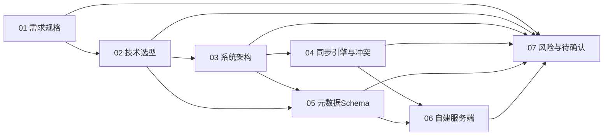

# 00 - 总览与阅读指南

> **TL;DR**：本项目是**跨平台电子书进度同步阅读应用**（正式名 SyncReader，Q1 拍板）：免费、无容量限制、同步完全由用户自己的存储承载（坚果云 WebDAV 或自建服务器）。M0-M4 已完成开发（M4 打磨分发含签名/安装器/性能/离线，见 §5），当前待真机验收收口，下一站 M5 服务端。八份文档构成完整设计基线（另有 docs/09 发布与分发），六大关键决策见 §3 速览，路线图见 [§4](#4-里程碑路线图)。

---

## 1. 一句话定位

用户在 Android（手机/平板）与 Windows（P1：iPad/macOS/Linux）上使用同一份书库、进度实时一致；同步走用户自己的坚果云或自建服务器，软件本身零云服务、零收费。

## 2. 文档地图

| 文档 | 内容 | 读者 |
| --- | --- | --- |
| [01-需求规格说明](./01-需求规格说明.md) | FR/NFR 逐条编号 + 验收标准 + 平台优先级 + 用户流程 | 全体 |
| [02-技术选型](./02-技术选型.md) | 六大决策 + 工程配套选型，每项含 ≥2 候选对比表与结论/风险 | 全体 |
| [03-系统架构设计](./03-系统架构设计.md) | 总体架构、模块与目录规划、核心接口（可直接开码）、数据流、平台适配 | 客户端/服务端开发 |
| [04-同步引擎与冲突解决](./04-同步引擎与冲突解决.md) | 同步状态机、diff 矩阵、冲突合并算法、删除语义、流量优化与估算 | 同步/客户端 |
| [05-元数据Schema与云端目录布局](./05-元数据Schema与云端目录布局.md) | 云端目录、meta JSON 字段级 schema、locator 定义、SQLite DDL、版本迁移 | 同步/客户端 |
| [06-自建服务端设计与部署](./06-自建服务端设计与部署.md) | REST API 端点规格、鉴权与多用户、Docker/systemd/Tailscale 部署 | 服务端 |
| [07-风险与待确认问题](./07-风险与待确认问题.md) | 全部默认假设（A）、待确认问题（Q）、风险（R）与决策变更影响图 | 全体 |

依赖关系：

## 3. 六大决策速览（详见 02）

| 决策点 | 结论 | 一句话理由 |
| --- | --- | --- |
| UI 框架 | **Flutter** | P0/P1 六端官方支持；自绘引擎天然胜任文本测量分页；阅读生态最全 |
| 格式渲染 | txt/md/epub 纯 Flutter 自渲染（epub_pro 解析、flutter_markdown_plus、自研分页）；pdf 用 **pdfrx** | 不依赖 WebView（官方 webview_flutter 不支持 Windows）；统一主题与进度定位 |
| 本地存储 | **drift（SQLite）** 管元数据/进度/同步状态 + 文件系统存正文 | 书库是多条件关系查询场景；六端无坑、可单测 |
| 服务端 | **Go 单二进制 + SQLite，自定义 REST API**（非 WebDAV 兼容） | 增量游标/每设备 token/多用户/CAS 乐观锁；统一 BackendAdapter 抽象保证与 WebDAV 模式语义一致 |
| 元数据 | 每书一个 JSON（`meta/{bookId}.json`）+ `schemaVersion`；两后端目录布局一致 | 单书级增量、冲突面最小、WebDAV 友好、可人工修复 |
| 冲突策略 | **LWW（rev → updatedAt → deviceId）+ tombstone**；totalSeconds 求和特例 | 心智简单、可预期；rev 单调性免疫时钟回拨 |

## 4. 里程碑路线图（建议）

| 里程碑 | 内容 | 出口标准 |
| --- | --- | --- |
| M0 工程奠基 | 初始化 Flutter 工程 + sync_core 包 + Go server 骨架；CI（analyze/test/build） | 空壳三端可构建 |
| M1 本地阅读闭环 | 书库管理（FR-1xx）+ txt/md 阅读器 + pdf（pdfrx）+ 本地进度；桌面插件验证（R1） | 无网络下完整可读 |
| M2 同步上线 | sync_core 状态机 + WebDAV 适配器 + 坚果云联调专项（R3）+ 契约测试 | 两台真机进度一致（FR-404 验收用例） |
| M3 客户端功能补全（2026-10-27 调整：服务端方案后置至 M5） | epub 渲染器（FR-203 P0）+ 游离文件面板 + 云端孤儿清理 + 文件替换同步（FR-410）+ 批量导入（FR-109）+ 配额面板增强 | epub 双端阅读与进度同步全链路；P1 同步体验项闭环 |
| M4 打磨分发 | 引导向导打磨、离线/弱网用例、P2 功能取舍、性能达标（NFR-04/05）、首发打包（安装器/签名） | P0 平台可安装分发 |
| M5 服务端扩展（原 M3 后置；**2026-10-28 用户决策：后置**，见 07-A18） | Go 服务端 + REST 适配器（契约套件第三跑，NFR-08） | 自建模式端到端走通 |

## 5. 当前状态

- ✅ 规划完成：本文档集即设计基线；
- ✅ M0 工程奠基完成（2026-10-26）：三工程骨架 + CI 就绪，`analyze`/`test` 全绿；环境搭建见 [08-开发环境搭建](./08-开发环境搭建.md)；
- ✅ M1 本地阅读闭环完成（2026-10-26）：书库管理（导入/去重/排序/搜索/详情/封面/删除）+ txt（编码检测/章节切分/分页与滚动）/md/pdf 阅读器 + 本地进度/阅读时长/阅读设置 + TOC 抽屉；app 293 测试全绿、Windows debug 构建通过。epub 渲染器按路线图随 M2/M3 交付；pdfrx 收编副本见 [07-R15](./07-风险与待确认问题.md)；
- ✅ M2 同步上线完成（2026-10-27，开发侧）：sync_core 引擎（Diff 七行矩阵 / (rev,updatedAt,deviceId) LWW 合并 / 五阶段状态机幂等重放 / TransferQueue 指数退避+Range 续传+字节计量 / SyncError 六类）+ WebDAV 适配器（仅六动词 / ETag 条件请求与 size+mtime 回退 / MOVE 能力探测 / 两级清单 etag→rev 缓存）+ App 接入（凭据仅安全存储 / 坚果云 4 步引导与连接测试 / 六种触发时机 / 占位书按需下载 / 配额闸门 / 全局与书级状态 / 删除 tombstone 推送 FR-408）；契约套件同一用例双跑（内存参考实现 + 标准/降级内存 WebDAV 服务器）；rclone v1.71.2 真实 HTTP 全流程联调通过；**坚果云真实环境联调完成**（R3 实测画像+适配器 409 兼容+双端收敛 FR-404 真实预演，见 [07-R3](./07-风险与待确认问题.md)）；sync_core 165 + app 359 测试全绿，Windows debug 构建通过。**待收口**：两真机（Windows+Android）FR-404 离线收敛验收（真实云端双引擎预演已通过）；flutter_secure_storage_windows 收编见 [07-R16](./07-风险与待确认问题.md)；
- ✅ M3 客户端功能补全完成（2026-10-28，开发侧）：epub 渲染器（FR-203：块化解析 + flutter_widget_from_html 渲染、分页/滚动双模式、NCX 跳转、epub locator 与 sync_core 互通、指纹门降级；复杂表格/浮动降级登记 [07-R2](./07-风险与待确认问题.md)）+ 游离文件面板（FR-408：三形态扫描/挂回/彻底删除）+ 云端孤儿清理（docs/04 §7.1 规则 4 工具化）+ 文件替换同步（FR-410：sync_core `replaceBookContent`/`uploadBook overwrite` 显式语义 + 详情页入口）+ 批量导入（FR-109）+ pdf 封面（FR-103）+ 配额面板 80% 常驻提醒（docs/04 §8.3）；sync_core 192 + app 514 测试全绿；FR-208 阅读时长按天统计（C3）按任务允许后置；
- ✅ M4 打磨分发完成（2026-10-28，开发侧）：**发布打包**（Android 正式签名 + 按 ABI 拆分 APK 32-36MB（apksigner 指纹验证）、Windows Inno Setup 安装器 16.5MB + 便携 zip 20.3MB、`scripts/package_release.ps1` 一键产出与 NFR-04 体积门、版本 1.0.0+1 pubspec 单点、applicationId `com.syncreader.app`、LICENSE=MIT（Q2 拍板）、CHANGELOG/README/docs/09 发布流程）；**性能达标**（NFR-05 启动打点机制 + Windows release 实测 firstFrame=136ms、FR-106 2000 本搜索中位 0.4ms 远低于 100ms 门，见 docs/08 §8）；**离线/健壮性**（FR-601 飞行模式 9 用例固化零报错弹窗、FR-604 导出日志含二次脱敏）；**补功能**（C3 FR-208 按天阅读时长 + schema v2 只增不删迁移、FR-107 分组标签、FR-209 音量键翻页；范围拍板登记 07-A17）；sync_core 192 + app 595 测试全绿。**待收口**：真机验收清单见 CLAUDE.md §7；
- ⬜ 下一站：v1.0.0 发布收口（真机验收 + tag/Release，docs/09 §5）→ v1.1 迭代打磨（后备池见 [07](./07-风险与待确认问题.md) A18）；M5 服务端已后置（07-A18）；
- ⬜ 待确认问题见 [07 §2](./07-风险与待确认问题.md)（Q1/Q2 已拍板，其余按默认推进）。

## 6. 相关文档

全部见 §2 文档地图；根目录 [CLAUDE.md](../CLAUDE.md) 为后续 AI 编码会话的项目上下文入口。
