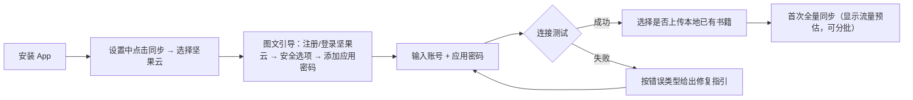

# 01 - 需求规格说明

> **TL;DR**：本文档把产品需求拆解到"可直接指导编码"的粒度：按模块编号功能需求（FR-xxx），逐条给出优先级与验收标准；非功能需求（NFR-xxx）给出可度量目标。平台优先级 **P0 = Android（手机+平板）+ Windows**，**P1 = iPad / macOS / Linux**（选型必须验证 P1 可达性）。本文是所有设计与选型文档的需求基线，技术方案见 [02-技术选型](./02-技术选型.md)，实现结构见 [03-系统架构设计](./03-系统架构设计.md)，同步行为规格见 [04-同步引擎与冲突解决](./04-同步引擎与冲突解决.md)。

---

## 1. 产品定位

**工作名：SyncReader**。一款免费、无容量限制的本地优先（local-first）电子书阅读应用：

- 用户在多个设备（Android 手机/平板、Windows PC，以及未来的 iPad/macOS/Linux）上使用**同一份书库**，阅读进度保持一致；
- 同步通道完全由**用户自己的存储**承载（坚果云 WebDAV 或自建服务器），应用本身不提供任何云服务、不收费、无账号体系；
- 无容量限制指：软件不对书库大小做任何人为限制，上限只取决于用户自己的存储空间与流量额度。

目标用户：

1. 非技术用户：希望"填个坚果云账号就能多端同步"；
2. 技术用户：愿意自建服务器（Docker 一条命令 / 家用机 / Tailscale 内网），换取多用户、增量同步等更强能力。

## 2. 平台范围与优先级

| 优先级 | 平台 | 说明 |
| --- | --- | --- |
| P0 | Android 8.0+（手机、平板） | 首发平台，需适配不同尺寸屏幕与分栏布局 |
| P0 | Windows 10 1809+（x64） | 桌面首发平台 |
| P1 | iPadOS 13+ | 选型必须验证构建链可达 |
| P1 | macOS 10.15+ | 同上 |
| P1 | Linux（glibc 2.31+ 主流发行版） | 同上，允许 P1 阶段功能子集（如缺系统 WebView 的降级方案） |

约束：所有 P0 功能必须在 P1 平台有明确的技术路径（不要求 P1 首发实现，但**不允许出现选型本身堵死 P1** 的情况）。可达性验证结论见 [02-技术选型](./02-技术选型.md) 各节"P1 可达性"。

## 3. 功能需求

优先级定义：**P0** = 初版必须；**P1** = 初版尽力、第一个迭代补齐；**P2** = 明确排期但可延后。

### 3.1 书库管理（FR-1xx）

| ID | 需求 | 优先级 | 验收标准 |
| --- | --- | --- | --- |
| FR-101 | 本地导入书籍：单文件/多选导入 txt、epub、md、pdf | P0 | 四种格式均可导入并出现在书库；重复导入同一文件（内容哈希相同）时提示"已存在"并复用条目 |
| FR-102 | 导入时解析基础元数据：书名（文件名/epub 元数据）、作者、格式、大小、内容哈希（SHA-256） | P0 | epub 优先取 OPF 元数据；其余格式取文件名（去扩展名，支持"书名 - 作者"模式识别作者）；哈希为流式计算，500MB 文件不卡 UI |
| FR-103 | 封面：epub 取封面图；txt/md 生成文字封面；pdf 取第一页缩略图 | P1 | 书库网格正确显示封面；无封面时显示统一风格文字封面 |
| FR-104 | 书籍详情页：显示元数据、进度、阅读时长统计，提供"打开/同步/删除"操作 | P0 | 各字段显示正确；删除行为符合 FR-408 |
| FR-105 | 书库视图：网格/列表切换，按最近阅读/书名/作者/添加时间排序 | P0 | 排序与切换即时生效 |
| FR-106 | 搜索：按书名/作者模糊搜索 | P0 | 2000 本规模下搜索响应 < 100ms |
| FR-107 | 分组/标签（**云端同步**，v1.4 起；2026-11-17 需求变更：用户要求"避免多端反复分组操作"） | P2（**已提前至 M4 首发**，2026-10-28 拍板） | ① 支持手动建组与拖拽归组；② **分组与书籍归属随云端同步**：A 端分组后，B 端同步一次即看到同样的分组与书籍归属（分组名、排序同步）；③ 分组改名、删除同步（删除分组不丢书，组内书回到"未分组"）；④ 两端各建同名分组时**合并为一个**（不重复出现）；⑤ 离线可用：分组操作本地立即生效，联网后补推；⑥ 双端并发改名按 LWW 收敛到一致 |
| FR-108 | 目录（TOC）侧栏：epub/pdf 展示解析出的目录；txt 按章节规则切分；md 按标题层级 | P0 | 点击目录跳转正确；txt 无章节时可手动不启用 |
| FR-109 | 批量导入：选择文件夹，扫描其中支持格式的文件 | P1 | 递归扫描，显示可导入文件清单供确认 |

### 3.2 阅读器（FR-2xx）

| ID | 需求 | 优先级 | 验收标准 |
| --- | --- | --- | --- |
| FR-201 | 打开书籍并恢复到上次阅读位置（本地进度；有网络时融合云端进度，规则见 FR-404） | P0 | 杀进程后重开，位置恢复一致 |
| FR-202 | txt 阅读：支持 GBK/UTF-8/UTF-16 等常见编码自动检测，可手动切换；章节切分；滚动与分页两种翻页模式 | P0 | 中文 GBK 老书不乱码；章节识别率对"第X章/卷/回"规则生效；分页模式页内排版稳定不跳动 |
| FR-203 | epub 阅读：解析并渲染文本、图片、内嵌样式（CSS 子集）；分页/滚动；目录跳转 | P0 | 常规小说类 epub（含图片、粗体/斜体、标题、引用）渲染正确；极端复杂排版（复杂表格、浮动布局）允许降级并在 07 记录风险 |
| FR-204 | md 阅读：渲染标题/列表/代码块/引用/图片/表格/链接；按标题分章 | P0 | GFM 常用语法渲染正确；代码块等宽字体与横向滚动 |
| FR-205 | pdf 阅读：页面渲染、缩放、页码跳转、目录跳转 | P0 | 100MB 以内 pdf 流畅翻页；双栏适配平板横屏（P1） |
| FR-206 | 阅读设置：字号、行距、页边距、主题（浅色/深色/纸张色）、字体选择 | P0 | 设置即时生效并持久化；**排版设置仅本地保存，不同步**（v1，记录于 07） |
| FR-207 | 进度记录：翻页/滚动时记录逻辑位置（locator），退出/切后台时落库 | P0 | locator 遵循 [05-元数据Schema](./05-元数据Schema与云端目录布局.md) 中对应格式定义 |
| FR-208 | 阅读时长统计：前台阅读计时，按天累计，写入元数据 | P1（**M4 已补做**，2026-10-28；本地 reading_days 表 + 详情页按天展示） | 切后台/锁屏暂停计时；误差 < 5% |
| FR-209 | 亮度调节与音量键翻页（Android） | P2（**拆分**：音量键翻页已随 M4 首发实现（默认关）；亮度调节不进首发，登记后续迭代） | — |
| FR-210 | 全文搜索（当前书内） | P2（M4 拍板**不进首发**，仅登记） | txt/md/epub 支持字符串搜索；pdf 走渲染库自带搜索 |

### 3.3 同步（FR-4xx）

| ID | 需求 | 优先级 | 验收标准 |
| --- | --- | --- | --- |
| FR-401 | 元数据先行同步：每次同步先拉取云端元数据变更，再按需传输正文文件 | P0 | 日常同步（无新书时）只传输元数据；行为规格见 [04](./04-同步引擎与冲突解决.md) |
| FR-402 | 正文按需下载：本地缺失的云端书籍，先以"仅元数据"占位显示在书库，点开时才下载正文 | P0 | 占位书籍有明确视觉标识；下载失败可重试且不丢占位 |
| FR-403 | 进度自动上传：阅读中进度变更经防抖后写入待同步队列，联网时自动上传 | P0 | 防抖策略见 [04 §4](./04-同步引擎与冲突解决.md)；飞行模式阅读、恢复网络后自动补同步 |
| FR-404 | 冲突解决：多设备并发修改按 [04 §6](./04-同步引擎与冲突解决.md) 定义的规则自动合并 | P0 | 验收用例：A/B 两端离线各读同一本书到不同位置，恢复网络后两端收敛到同一进度 |
| FR-405 | 同步两种后端可配置：坚果云 WebDAV（引导式配置）或自建服务器（地址+凭据），同一时刻启用其一 | P0 | 配置向导见 FR-50x；切换后端时给出"本地书库保留、需重新关联云端"的明确提示 |
| FR-406 | 同步状态可视化：全局"上次同步时间/进行中/失败原因"，书籍级"云端最新/待上传/待下载" | P0 | 失败时给出可理解的原因（如坚果云流量超额、密码错误、网络不可达） |
| FR-407 | 坚果云流量额度保护：统计每月上行/下行流量，达到阈值告警，超限前阻止大文件自动下载 | P0 | 阈值（默认上行 800MB/下行 2.4GB，即额度的 80%）触发提醒；自动下载排队等待用户确认 |
| FR-408 | 删除语义（v1.1 变更，docs/10 §4.7b）：应用内删除一本书 = **删除本地正文/封面文件（真正删盘）+ 保留元数据（`books` 行保留、`local_path` 置 NULL，落书库「未下载」区）+ 写 tombstone 同步到云端**；**不删除**云端正文文件，**不删除**其他设备上的本地正文文件 | P0 | 删除后书仍在书库「未下载」区、进度保留（同文件重新导入可恢复位置）、同步不把它推回云端；其他设备收到 tombstone 后书从书库消失但本地文件保留为"游离文件"；规则详见 [04 §7.1](./04-同步引擎与冲突解决.md) |
| FR-409 | 手动触发：下拉刷新 / 设置页"立即同步"按钮 | P0 | — |
| FR-410 | 书籍文件修改同步：本地文件内容变化（重新导入同 hash 或用户替换文件）时更新云端正文与元数据哈希 | P1 | 触发方式：详情页"重新选择文件"；自动监听文件变化不在 v1 范围 |

### 3.4 后端配置（FR-5xx）

| ID | 需求 | 优先级 | 验收标准 |
| --- | --- | --- | --- |
| FR-501 | 坚果云引导式配置：分步说明如何生成应用密码，仅需输入账号+应用密码即可测试连接成功 | P0 | 从"开始配置"到"连接成功"不超过 4 步；连接测试验证目录可读写 |
| FR-502 | WebDAV 通用模式：允许自定义服务器地址（兼容其他 WebDAV 服务） | P1 | 地址、目录、账号、密码均可编辑 |
| FR-503 | 自建服务器配置：输入服务器地址+用户名密码（或配对 token） | P0 | 支持 `http(s)://host:port`；内网 http 明文时给出安全提示并要求确认 |
| FR-504 | 凭据安全存储：WebDAV 账号/应用密码、服务器 token 一律写入系统安全存储（Keystore/DPAPI/Keychain），不落明文 | P0 | 数据目录文件与数据库中不可见明文凭据 |
| FR-505 | 连接测试与诊断：配置页提供"测试连接"，显示往返延迟、目录权限检查结果 | P0 | 失败原因分类：DNS/超时/401/403/5xx |

### 3.5 通用（FR-6xx）

| ID | 需求 | 优先级 | 验收标准 |
| --- | --- | --- | --- |
| FR-601 | 离线可用：无网络时阅读、翻书、导入全部正常 | P0 | 飞行模式下核心链路无网络调用报错弹窗 |
| FR-602 | 多语言：界面中文优先，文案集中在资源文件，预留英文 | P1 | — |
| FR-603 | 深色模式跟随系统 | P0 | — |
| FR-604 | 日志：分级日志（默认 info），同步引擎关键路径有结构化日志，凭据字段脱敏 | P0 | 导出日志功能（P1）用于问题排查 |

## 4. 非功能需求（NFR）

| ID | 类别 | 要求与目标 |
| --- | --- | --- |
| NFR-01 | 免费开源 | 全链路仅使用免费/开源组件（客户端框架、渲染库、服务端运行时、部署工具）；不引入任何付费 SDK 或云服务依赖 |
| NFR-02 | 离线优先 | 本地书库与阅读完全不依赖网络；同步失败静默重试，不打断阅读 |
| NFR-03 | 凭据安全 | 见 FR-504；传输层要求 HTTPS（坚果云默认；自建服务器推荐 Caddy/Tailscale，内网 http 需显式确认）；日志与崩溃上报不包含凭据与书内容 |
| NFR-04 | 安装包体积 | Android APK（按 ABI 拆分后单个）≤ 60MB；Windows 安装包 ≤ 120MB；不为体积做过度优化 |
| NFR-05 | 启动速度 | Android 中端机冷启动到书库可交互 ≤ 2.5s；Windows ≤ 3s |
| NFR-06 | 流量预算 | 见 [04 §8](./04-同步引擎与冲突解决.md) 估算表：日常元数据同步单设备每月 ≤ 20MB（500 本规模）；首次全量同步提供预估与分批确认 |
| NFR-07 | 规模上限（设计目标） | 书库 ≤ 2000 本；单文件 ≤ 500MB；超过时功能可用但性能不承诺 |
| NFR-08 | 可维护性 | 同步核心逻辑（sync_core）为纯 Dart 包、不依赖 UI 与平台通道，契约测试同时覆盖 WebDAV 与自建服务器两种适配器 |
| NFR-09 | 隐私 | 应用自身零遥测；崩溃与日志仅本地保存 |

## 5. 关键用户流程

### 5.1 非技术用户（坚果云模式）

### 5.2 技术用户（自建模式）

部署（Docker Compose 一条命令，详见 [06-自建服务端设计与部署](./06-自建服务端设计与部署.md)）→ 客户端填服务器地址与账号 → 连接测试 → 首次同步。

### 5.3 日常阅读与换设备

设备 A 阅读（进度本地即时落库 + 防抖后上传元数据）→ 设备 B 打开 App → 元数据同步发现 A 的新进度 → 打开同书恢复到该位置。无正文文件的书按需下载（FR-402）。

## 6. 范围外（Non-Goals）

以下内容**不在本项目范围内**（含关联假设，统一登记于 [07-风险与待确认问题](./07-风险与待确认问题.md)）：

- 不提供任何官方云服务、账号体系、书城/在线书源；
- 不支持 DRM 加密书籍（如 Kindle 加密格式）；
- 不做笔记/批注社区分享；批注本地保存，云端同步作为 v2 预留字段；
- 不做 TTS、翻译、AI 辅助阅读（v1）；
- 不支持书籍格式转换（如 epub→txt）。

## 7. 相关文档

- 技术选型与备选方案对比：[02-技术选型](./02-技术选型.md)
- 系统与模块结构：[03-系统架构设计](./03-系统架构设计.md)
- 同步行为规格（触发时机、冲突、删除、流量）：[04-同步引擎与冲突解决](./04-同步引擎与冲突解决.md)
- 云端元数据 schema 与本地表结构：[05-元数据Schema与云端目录布局](./05-元数据Schema与云端目录布局.md)
- 自建服务器 API 与部署：[06-自建服务端设计与部署](./06-自建服务端设计与部署.md)
- 假设与开放问题登记：[07-风险与待确认问题](./07-风险与待确认问题.md)
