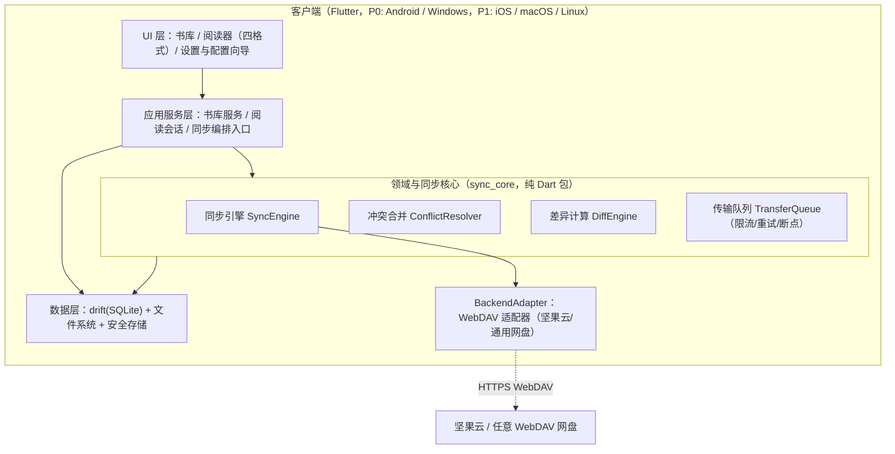
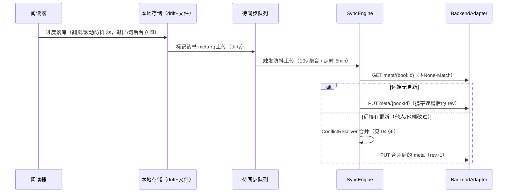
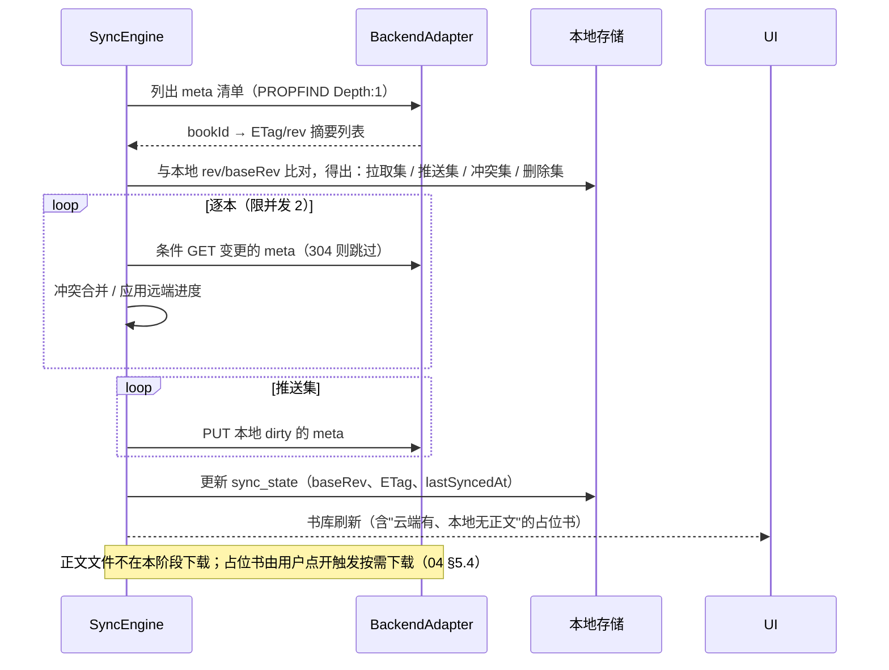
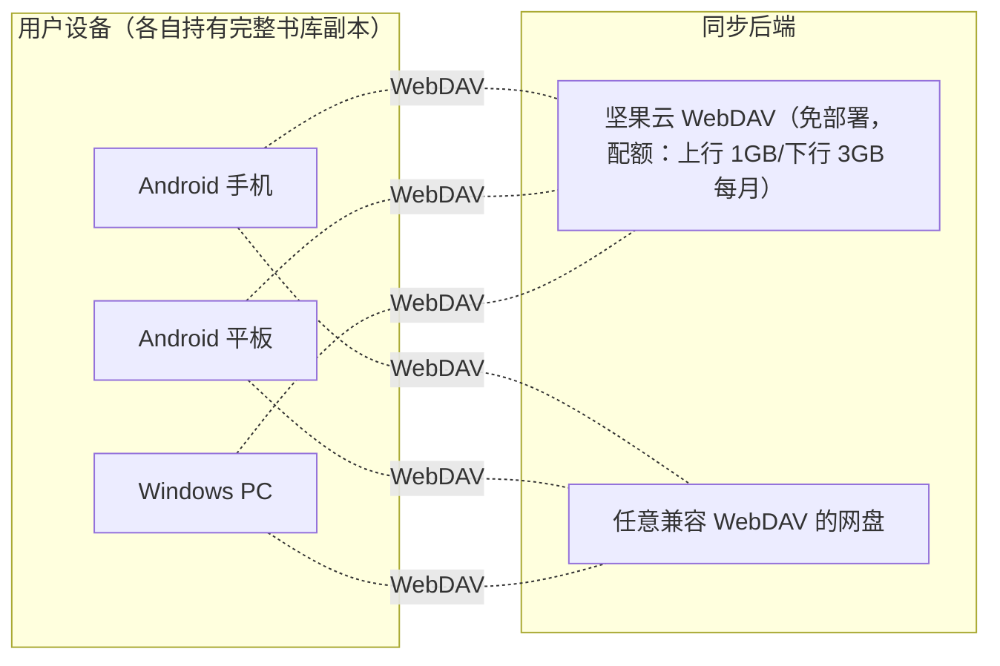

# 03 - 系统架构设计

> **TL;DR**：整体为"**一个客户端 + 一个可插拔同步后端**"两部分。客户端采用分层架构（UI → 应用服务 → 领域 → 数据），同步引擎 `sync_core` 是**独立纯 Dart 包**，通过 `BackendAdapter` 统一接口对接 WebDAV 网盘（坚果云或任意兼容网盘）。**冲突合并永远在客户端**：远端只做"带版本校验的存储"，元数据语义、diff 判定与 LWW 合并全部由 `sync_core` 决定。本文给出模块划分、接口签名、关键数据流与错误处理约定。

---

## 1. 总体架构



要点：

1. **同一时刻只启用一个 BackendAdapter**（用户在设置中选择，FR-405）；切换后端时本地书库保留，云端关联重建（提示见 FR-405）。
2. `sync_core` 不依赖 Flutter（可被单元测试与未来 CLI 工具复用），只依赖 dio/xml 等纯 Dart 包。
3. **冲突裁决在客户端**：`sync_core` 拉取远端 meta，与本地版本合并后再整体覆盖写入（WebDAV 下写前先重读远端，ETag 不符即视为冲突）。远端不做任何业务合并，保证各端语义一致（见 [04 §6](./04-同步引擎与冲突解决.md)）。

## 2. 客户端工程结构

```
sync-reader/
├── docs/                          # 设计基线文档集
├── apps/sync_reader/              # Flutter 客户端
│   ├── lib/
│   │   ├── app/                   # 入口、路由、主题、DI 容器
│   │   ├── core/                  # 通用：result 类型、错误、日志、ULID、扩展
│   │   ├── features/
│   │   │   ├── library/           # 书库 UI 与服务（FR-1xx）
│   │   │   ├── reader/            # 阅读器框架 + formats/{txt,epub,md,pdf}/
│   │   │   ├── sync/              # 同步设置页、状态展示、配额面板（FR-4xx/5xx）
│   │   │   ├── settings/          # 设置页、存储占用
│   │   │   ├── onboarding/        # 首启引导、后端配置向导（FR-50x）
│   │   │   └── shell/             # 应用外壳（侧栏/顶栏/路由骨架）
│   │   ├── data/
│   │   │   ├── db/                # drift 表、DAO、迁移
│   │   │   ├── files/             # 书籍/封面文件存取
│   │   │   ├── secure/            # 凭据读写封装
│   │   │   └── sync/              # drift 侧同步状态与本地库
│   │   └── shared/                # 通用组件与文案
│   └── test/
├── packages/
│   ├── sync_core/                 # 纯 Dart：同步引擎（无 Flutter 依赖）
│   │   ├── lib/src/
│   │   │   ├── engine/            # SyncEngine、状态机
│   │   │   ├── diff/              # DiffEngine
│   │   │   ├── conflict/          # ConflictResolver
│   │   │   ├── transfer/          # TransferQueue、重试、断点
│   │   │   ├── backend/           # BackendAdapter 接口 + webdav/ + memory/
│   │   │   ├── store/             # 本地库（drift）适配
│   │   │   └── model/             # BookMeta、Locator、Tombstone、SyncCursor
│   │   └── test/                  # 契约测试（同一套用例跑多个适配器形态）
│   └── third_party/               # 收编的第三方包副本（pdfrx、flutter_secure_storage_windows）
└── scripts/                       # 打包、图标、页面边界检查、桌面驱动脚本
```

约定：`features/` 内按界面组织，跨界面共享的领域逻辑下沉到 `sync_core` 或 `data/`；`sync_core` 内禁止 import Flutter。

## 3. 数据流总览

### 3.1 阅读会话（进度产生 → 云端）



### 3.2 App 启动 / 恢复网络（元数据先行）



## 4. 核心接口定义（可直接开码）

### 4.1 领域模型（`sync_core/lib/src/model/`）

```dart
class BookMeta {            // 与云端 meta/{bookId}.json 一一对应
  final int schemaVersion;  // 见 05 §6
  final String bookId;      // ULID
  final int rev;            // 单调递增，写端维护
  final String deviceId;
  final String deviceName;
  final DateTime createdAt;
  final DateTime updatedAt;
  final bool deleted;       // tombstone 标记
  final DateTime? deletedAt;
  final BookInfo info;      // 书名/作者/格式/文件名/大小/contentHash
  final ReadingProgress? progress;
  final ReadingStats stats; // totalSeconds、lastReadAt
  final Map<String, Object?> extra; // 向前兼容字段
}

class ReadingProgress {
  final Locator locator;    // 判别联合，见 05 §3.3
  final double percent;     // 0.0-1.0，跨格式统一展示用
  final DateTime updatedAt;
}
```

### 4.2 格式扩展点（阅读器侧，对应 [02 §D2.5](./02-技术选型.md)）

```dart
abstract interface class BookFormatHandler {
  String get formatId;                                  // 'txt' | 'epub' | 'md' | 'pdf' | 未来 'mobi'...
  bool canHandle(String ext, Uint8List magicHeader);
  Future<ParsedBook> parseMetadata(BookFile file);      // 书名/作者/TOC/编码
  Future<BookRenderer> createRenderer(                 // 打开阅读页时
    BookFile file, ReaderSettings settings, ProgressAnchor anchor);
}

// 在 FormatRegistry 注册；同步层只消费 formatId 字符串，格式无关。
```

### 4.3 BackendAdapter（同步后端抽象）

```dart
abstract interface class BackendAdapter {
  BackendKind get kind; // webdav（`server` 枚举值仅占位，当前无实现）

  Future<void> connect(BackendConfig cfg);            // 含连接测试
  Future<void> ensureLayout();                        // 首次：建目录/library.json（幂等）

  /// 元数据清单：返回 {bookId: RemoteMetaStub(rev/etag/size/mtime)}
  /// WebDAV: PROPFIND Depth:1 on meta/
  Future<MetaListing> listMetas({SyncCursor? cursor});

  Future<BookMeta?> getMeta(String bookId, {String? ifNoneMatch}); // null+304 语义
  Future<void> putMeta(BookMeta meta);                // WebDAV：写前重读，ETag 不符即冲突
  Future<void> putTombstone(BookMeta tombstoned);     // deleted=true 的 meta PUT

  // 分组（FR-107，v1.4；独立文件类型 groups/{groupId}.json，docs/05 §2.1）
  Future<GroupListing> listGroups();                  // 分组清单（含名称：同名去重要用）
  Future<GroupMeta?> getGroup(String groupId, {String? ifNoneMatch}); // null+304 语义
  Future<void> putGroup(GroupMeta meta, {required int expectedRev}); // CAS：落后抛 GroupRevConflict
  Future<void> deleteGroupMeta(String groupId);       // 同名去重清理 + 墓碑 GC（404 幂等）

  Future<Stream<List<int>>> downloadBook(String bookId,
      {int? startByte});                              // 支持 Range 续传
  Future<void> uploadBook(String bookId, File file,
      String contentHash);                            // tmp/.part → MOVE/提交（幂等：hash 相同即跳过）

  Future<void> dispose();
}
```

`TransferQueue` 包装上述接口，提供：并发上限（下载 2 / 上传 1）、指数退避重试（1s→2s→4s→…→上限 5min，见 [04 §8.4](./04-同步引擎与冲突解决.md)）、字节计量（坚果云配额保护 FR-407）、断点续传（下载 Range；上传 v1 整体重传）。

**分组能力**：分组是**独立文件类型**（`groups/{groupId}.json`），
不与书籍 meta 混放（`meta/` 的 Depth:1 PROPFIND 用于枚举书籍，混入分组文件
会污染清单与去重逻辑）。适配器只做传输：分组清单、读、写（CAS）、删
（去重清理 / 墓碑 GC）四个动作；**同名分组的名称级合并、rev/CAS/LWW 全部
在 sync_core 完成**（docs/04 §5.1.1、§6.3.1）。契约套件以同一用例跑
memory / WebDAV 标准 / WebDAV 降级三形态。

### 4.4 凭据存取

```dart
abstract interface class CredentialStore {
  Future<void> save(String key, String secret); // key 例：'webdav.account'、'webdav.password'
  Future<String?> read(String key);
  Future<void> delete(String key);
}
// 实现：flutter_secure_storage（Android Keystore / Windows DPAPI / iOS Keychain / Linux libsecret）
// 约束：禁止写入 SQLite、日志、崩溃报告（NFR-03）；日志层对 CredentialStore 键值强制脱敏。
```

## 5. 平台适配层

| 能力 | Android | Windows | iOS/macOS (P1) | Linux (P1) |
| --- | --- | --- | --- | --- |
| 安全存储 | Keystore（flutter_secure_storage） | DPAPI（同上） | Keychain | libsecret |
| 文件选择 | SAF（file_picker） | 原生对话框 | 原生 | GTK |
| 后台触发同步 | workmanager + 前台定时器 | 进程内定时器 + 启动触发 | BGTaskScheduler（P1 评估） | 定时器 |
| 网络可达性监听 | connectivity_plus | 同左 | 同左 | 同左 |
| 窗口/生命周期 | — | window_manager（记忆尺寸位置） | — | — |
| 字体 | 系统字体 + 内置开源中文字体（思源黑体/宋体子集，按需） | 系统字体 | 系统字体 | fontconfig |

## 6. 错误处理与可观测性

1. **错误分类**（统一 `SyncError` 层级）：`NetworkUnreachable / AuthFailed / QuotaExceeded（坚果云流量超限）/ ConflictUnresolvable / ServerError / Corruption`；UI 只展示分类文案，不暴露堆栈（FR-406）。
2. **重试策略**：见 [04 §8.4](./04-同步引擎与冲突解决.md)；`AuthFailed` 直接引导重新授权（WebDAV 401）。
3. **日志**：talker 分级；同步引擎关键事件（阶段迁移、请求计数、字节计量）结构化输出；凭据/书名等敏感字段按 [04 §9](./04-同步引擎与冲突解决.md) 脱敏规则处理。
4. **一致性自检**：启动时对 SQLite 与文件系统做懒校验（书籍文件缺失 → 标记待重新下载；孤儿文件 → 列入"游离文件"面板）。

## 7. 部署视图



同步后端由用户在设置中选择：默认坚果云（引导式配置，官方测试背书），也可切换到其他兼容 WebDAV 的网盘；同一时刻只启用一个后端。

## 8. 相关文档

- 需求基线：[01-需求规格说明](./01-需求规格说明.md) ｜ 选型依据：[02-技术选型](./02-技术选型.md)
- 同步行为规格：[04-同步引擎与冲突解决](./04-同步引擎与冲突解决.md) ｜ 数据 schema：[05-元数据Schema与云端目录布局](./05-元数据Schema与云端目录布局.md)
- 风险登记：[07-风险与待确认问题](./07-风险与待确认问题.md)
