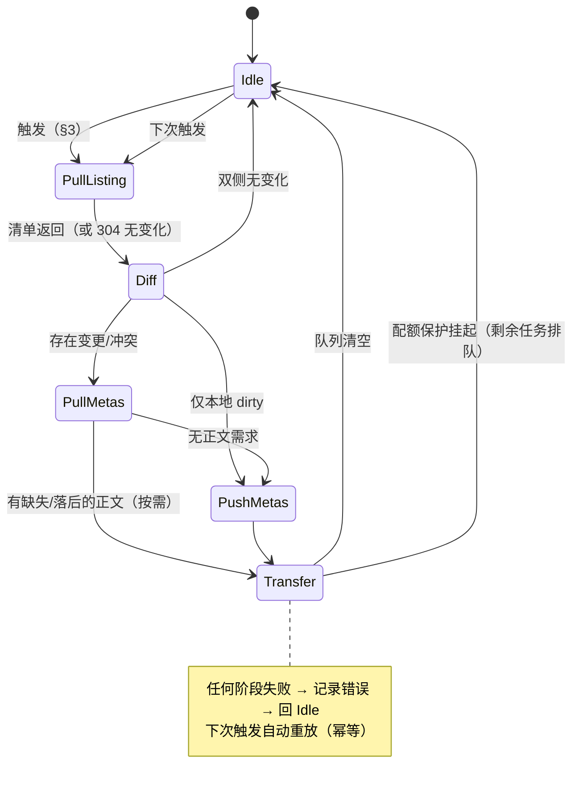
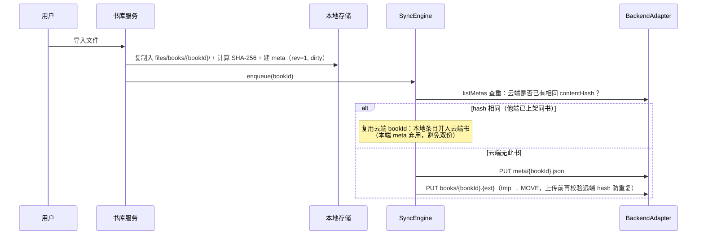

# 04 - 同步引擎与冲突解决

> **TL;DR**：同步遵循"**元数据先行、正文按需、本地优先、幂等可重放**"四原则。单次同步 = `拉取清单 → 差异比对 → 元数据合并 → 按需传输 → 落游标` 五阶段状态机；书籍以 `(rev, updatedAt, deviceId)` 做 LWW 冲突合并（`rev` 单调递增兜底时钟回拨），删除走 tombstone——**云端正文永不删除；本端删除时本地正文文件也直接删盘、该书从书库移除（用户显式操作，见 §7.1），其余设备的本地正文一律保留为"游离文件"**。流量上靠 ETag 条件请求、清单合并、哈希去重、Range 续传与指数退避重试，把日常同步压到"每设备每月 ≤ 20MB"量级，适配坚果云 1GB 上行 / 3GB 下行的免费额度。本文是同步行为的**完整编码规格**，schema 细节见 [05](./05-元数据Schema与云端目录布局.md)。

---

## 1. 设计原则

1. **本地优先**：阅读、导入、删除立即作用于本地，同步是异步旁路，任何同步失败不影响本地操作。
2. **元数据先行**：每次同步先只拉元数据清单与变更元数据（KB 级、高频），正文文件（MB 级、低频）仅在本地缺失或落后时按需传输。
3. **幂等可重放**：所有写操作（PUT meta / PUT tombstone / uploadBook）可安全重放；崩溃/断网后下次同步自动收敛，无需人工干预。
4. **语义双端一致**：WebDAV 与自建 REST 两种后端在本文定义的所有规则下行为一致；差异只存在于传输函数实现（`BackendAdapter`，见 [03 §4.3](./03-系统架构设计.md)），由同一套契约测试保证（NFR-08）。

## 2. 核心概念

| 概念 | 定义 | 存储 |
| --- | --- | --- |
| `rev` | 每本书元数据的版本号。**写端维护**：每次本地修改进度/信息/删除时 `rev = 本地持久计数器 + 1`；上传成功后记入 `baseRev` | 云端 meta JSON 字段；本地 `sync_state` |
| `baseRev` | 本地已确认"云端为该版本"的 rev，是下次冲突检测的基准 | 本地 sync_state |
| `contentHash` | 正文文件的 SHA-256（`sha256-hex`），流式计算，导入时一次、重新导入时重算 | meta.book.contentHash |
| tombstone | `deleted=true` 的 meta 文件，含 `deletedAt`，保留期 30 天后可 GC | 云端 meta/；本地 deleted_books 表 |
| 游离文件（orphan） | 本地存在正文与文件，但云端无对应 meta（**其它端**删除后本地正文仍保留的情形；v1.1 起本端删除直接删盘，见 §7.1） | 仅本地；不参与任何自动清理 |
| 仅本地（local-only） | 本地有正文、云端没有，且本端**不会**把它传上去（导入时选"不上传"，或"从云端移除"后落第 7b 行） | 仅本地；本地 `local_only_books` 表标记 |
| `cursor` | 自建服务器模式的增量游标（服务端全局序列号），WebDAV 模式无游标、靠 PROPFIND+ETag | 本地 per-backend |
| `deviceId` | 首次启动生成的 ULID，参与冲突决胜 | 本地；不占云端文件 |

## 3. 同步触发时机

| 触发源 | 时机 | 动作 | 备注 |
| --- | --- | --- | --- |
| 应用启动 | 冷启动完成后 2s | 全量同步（阶段 1-5） | 后台静默执行 |
| 回到前台 | 切后台 > 5min 后回前台 | 全量同步 | 移动端高频场景 |
| 进度变更 | 阅读中防抖 10s / 退出阅读页立即 | 单书 meta 上传（阶段 4 的推送子集） | 不拉清单，直达推送 |
| 网络恢复 | connectivity 变为可用 | 全量同步 | 覆盖离线阅读场景 |
| 定时器 | 前台期间每 15min | 全量同步 | 兜底 |
| 手动 | 下拉刷新 / 设置页按钮 | 全量同步 | UI 可见进度 |
| 书籍打开 | 点开占位书（本地无正文） | 该书正文按需下载（§5.4） | 计入配额保护 |

配置项：自动同步总开关、仅 Wi-Fi 同步正文（元数据不受限，默认开）。

## 4. 同步状态机



阶段说明：

| 阶段 | WebDAV 实现 | REST 实现 | 输出 |
| --- | --- | --- | --- |
| 1 PullListing | `PROPFIND meta/ Depth:1`（一次拿到全部 bookId 的 ETag+size+mtime） | `GET /sync/changes?cursor=n`（服务端返回增量，含 tombstone） | `MetaListing` |
| 2 Diff | 本地 sync_state（baseRev/etag）× 清单 → 五类集合（§5.1 矩阵） | 同左（远端 rev 由服务端直报） | 拉取集/推送集/冲突集/删除集/新增集 |
| 3 PullMetas | 逐本 `GET meta/{id}` 带 `If-None-Match`（304 跳过），并发 2 | 批量响应已在阶段 1 返回完整 meta | 本地更新后的 BookMeta 列表 + 冲突待合并列表 |
| 4 PushMetas | 逐本 `PUT meta/{id}`（写前重读远端，冲突则合并后写） | `PUT /meta/{id}` 带 `If-Match: baseRev`（409 时取服务端副本合并重试） | 推送完成 |
| 5 Transfer | 缺失正文：`GET books/{id}.{ext}` 支持 Range；新书上架：`PUT books/{id}.part` → `MOVE` | 同语义 REST 端点；上传可选分块（v2） | 文件就位 + meta.contentHash 校验 |
| 落游标 | 记录每本 etag/baseRev + lastSyncedAt | 记录服务端 cursor | — |

> **分组维度（FR-107，v1.4）**：分组是独立文件类型（`groups/{groupId}.json`，
> [05 §2.1](./05-元数据Schema与云端目录布局.md)），在同一条五阶段流水线上
> **并行**跑一遍，不另起状态机：
>
> | 阶段 | 分组动作 | 顺序要求 |
> | --- | --- | --- |
> | 1 PullListing | `listGroups()`：列 `groups/`（WebDAV 同款两级清单：PROPFIND + 必要时逐本补拉取 rev/名称） | 与书籍清单同阶段 |
> | 2 Diff | 分组 Diff（§5.1 分组矩阵）+ **同名分组合并**（[05 §2.1.1](./05-元数据Schema与云端目录布局.md)） | **合并先于书籍 Diff**：合并会迁移书籍 `group_id`，书籍快照随后才取，才能把新 `groupId` 一起推上云 |
> | 3 PullMetas | 拉分组 meta（`GET groups/{id}.json`，If-None-Match 304 跳过） | **分组先于书籍**：书籍 meta 携带 `groupId`，先落分组才能保证不写悬空外键 |
> | 4 PushMetas | 推分组 meta（`PUT groups/{id}.json`，写前重读 CAS，冲突则合并后重试恰一次）；同名去重的云端冗余条目清理 | **分组先于书籍**：云端先有分组，再推书籍归属 |
> | 5 Transfer | 无（分组无正文） | — |
>
> 失败隔离：分组阶段的失败只影响分组维度（记 `SyncReport.groupResults` /
> `groupPhaseError`），**不影响书籍同步**（本地优先，§1.3）。

## 5. 差异比对与传输决策

### 5.1 Diff 决策矩阵

对清单中每个 `bookId`，设本地状态 L（存在性、baseRev、本地未推送的 dirty 修改）、远端状态 R（存在性、rev、是否 tombstone）：

| 本地 | 远端 | 判定 | 动作 |
| --- | --- | --- | --- |
| 有，dirty=false | 有，rev == baseRev | 同步 | 无 |
| 有，dirty=false | 有，rev > baseRev | 落后 | 拉取 meta → 应用远端（进度/信息覆盖本地；正文缺失则进按需下载） |
| 有，dirty=true | 有，rev == baseRev | 领先 | 推送 meta（rev+1） |
| 有，dirty=true | 有，rev > baseRev | **冲突** | §6 合并流程 → 推送合并结果 |
| 无 | 有（非 tombstone） | 新书（云端新增） | 拉取 meta → 书库显示占位（FR-402）；正文按需下载 |
| 无 | 有（tombstone） | 云端已删 | 本地无正文则无操作；有正文则转为游离文件并提示（§7） |
| 有（dirty 与否） | 无 | **本地多出的书** | **不删除**（需求明确）。若从未推送过 → 视为本地新书，正常推上架；若曾有 baseRev 而远端 meta 消失（被网盘侧手工删除等异常）→ 保留本地，标记"云端缺失"待用户处理 |

### 5.1.1 分组 Diff 矩阵（FR-107，v1.4）

对清单中每个 `groupId`，设本地状态 L（存在性、是否已软删、baseRev、本地
未推送的 dirty 修改）、远端状态 R（存在性、rev、是否墓碑）：

| 本地 | 远端 | 判定 | 动作 |
| --- | --- | --- | --- |
| 有，未删，dirty=false | 有，rev == baseRev | 同步 | 无 |
| 有，未删，dirty=false | 有，rev > baseRev | 落后 | 拉取分组 meta → 应用（改名/排序） |
| 有，未删，dirty=true | 有，rev == baseRev | 领先 | 推送分组 meta（rev+1） |
| 有，未删，dirty=true | 有，rev > baseRev | **冲突** | §6.1 合并流程 → 推送合并结果 |
| 有，**已软删** | 有（未删） | 本地删除 | 推分组墓碑（§7.1 分组同款语义） |
| 有，已软删 | 无 / 墓碑 | 已删除且云端已无 | 无操作（幂等） |
| 无 | 有（非墓碑） | 云端新增分组 | 拉取分组 meta → 本地建组 |
| 无 | 有（墓碑） | 云端已删 | 无操作 |
| 有（dirty 与否） | 无 | **本地多出的分组** | **不删除**（同 §7 第 7b 行）。若从未推送过 → 视为本地新分组上架；若曾有 baseRev 而远端消失 → 保留本地，标记"云端缺失" |

**dirty 的判定**（app 层）：分组的 `name` / `sortOrder` 与上次同步副本
（`group_sync_state.last_synced_group_json`）不一致即为 dirty——分组没有
"进度表"那样的脏标记列，靠与公共祖先副本比对得出（docs/05 §5）。

**同名分组合并**在分组 Diff 之前执行（[05 §2.1.1](./05-元数据Schema与云端目录布局.md)）：
两台设备各自建了同名分组时，按名称聚类取规范 id（簇内字典序最小者），
其余 id 的本地行删除、组内书籍 `group_id` 迁移到规范 id；云端冗余条目在
规范分组确实存在于云端时删除。

**参与 diff 的前提（两条排除规则）**：以下两类书**不进入 diff**，矩阵对其
一律不适用（app 层在 `LocalLibrary.listBooks()` 侧排除，docs/10 §4.7b/§4.7c）：

| 排除项 | 判定依据 | 为什么 |
| --- | --- | --- |
| **本地已删除的书** | 本地 `deleted_books` 有该 bookId 的墓碑 | 墓碑已推云端；若再把它当正常书推回去，会与墓碑打架（同一 bookId 先正常 meta 后 tombstone，rev 链自相矛盾） |
| **仅本地的书** | 本地 `local_only_books` 有该 bookId | 用户明确选择"不上传"：既不推 meta 也不传正文（心智模型＝"这台设备自己导入过一次，但没上传"） |

两者的「恢复上架」动作都是**清掉标记 + 清 `baseRev` + 触发一次全量同步**，
从而重新落第 7a 行（本地新书从未推送过 → 推 meta + 传正文）。

### 5.2 首次连接/全量同步

1. `ensureLayout()`：幂等创建 `library.json / meta/ / books/ / tmp/ groups/`
   （已存在即跳过；老版本云端目录没有 `groups/` 时首次同步自动补建，
   **不得因目录缺失报错**）；
2. 若 `meta/` 为空 → 本地全部书籍视为"新书"批量上架（上传 meta + 正文），显示**流量预估并请求确认**，正文按 `单文件大小` 排序分批传输（每批默认 200MB，可暂停）；
3. 若 `meta/` 非空（如换设备/重装）→ 走 §5.1 矩阵：拉全部 meta → 本地正文缺失的书进按需下载队列（默认暂停等待用户确认，防止坚果云流量瞬间打爆，FR-407）。

### 5.3 新书导入（本端上架）



哈希去重规则：**以 contentHash 为准全局去重**——无论哪端先上架，第二端不再上传正文，只引用云端文件（bookId 取两端中字典序较小者，另一端 meta 写 tombstone，`dedupOf` 字段指向保留者，见 [05 §4](./05-元数据Schema与云端目录布局.md)）。

### 5.4 正文按需下载

1. 占位书被点开 → 校验配额余量（WebDAV 模式）→ `GET books/{bookId}.{ext}`；
2. 下载中显示进度与取消；**Range 续传**：已下载字节落 `.part` 临时文件，中断后从 `bytes=已有长度-` 继续；
3. 完成后本地重算 SHA-256 与 meta.contentHash 比对，不一致 → 删除重来（最多 2 次）→ 仍失败报 `Corruption`；
4. 本地存储不足 → 中止并提示清理空间。

## 6. 冲突解决（完整规则）

### 6.1 触发条件

Diff 阶段发现 `本地 dirty && 远端 rev > 本地 baseRev`（§5.1 第 4 行）；或推送时服务端 CAS 返回 409（REST 模式兜底）；或 WebDAV 写前重读发现远端 ETag 与预期不符。

### 6.2 定序规则

胜者 = 三元组 `(rev, updatedAt, deviceId)` 大者：

1. 先比 `rev`（整数，大者胜）——`rev` 由写端单调递增，**时钟回拨不影响正确性**；
2. `rev` 相同（如两端基于同一 baseRev 并发修改后各自 rev+1，可能出现相等）→ 比 `updatedAt`（毫秒，大者胜）；
3. 仍相同 → `deviceId` 字典序大者胜（保证任意两端得出**相同**的合并结论，收敛性关键）。

### 6.3 合并算法（胜者框架下的字段级特例）

```text
merge(local, remote):
    winner, loser = order_by((rev, updatedAt, deviceId))
    m = copy(winner)                       # 框架字段：书信息、进度、locator 全取胜者
    m.rev = max(local.rev, remote.rev) + 1
    m.updatedAt = now(); m.deviceId = 本机
    # 字段级特例（累积型字段，覆盖会丢数据）：
    m.stats.totalSeconds = local.stats.totalSeconds + remote.stats.totalSeconds
                           - max(base.commonAncestor.totalSeconds, 0)   # 以 baseRev 时点的值为公共祖先，减去共享部分避免双计
    m.stats.lastReadAt     = max(local.lastReadAt, remote.lastReadAt)
    return m
```

> 实现注：`commonAncestor` 取本地 `sync_state` 中缓存的上次同步副本（`lastSyncedMeta`，见 [05 §5](./05-元数据Schema与云端目录布局.md)）。若缓存缺失（重装），退化为直接求和（偏乐观，误差仅为重装期间的阅读时长）。

### 6.3.1 分组冲突合并（FR-107，v1.4）

分组冲突走与书籍**完全相同**的胜者框架（分组无进度，字段更少）：

```text
mergeGroup(local, remote):
    winner, loser = order_by((rev, updatedAt, deviceId))    # 同一 LWW 定序
    m = copy(winner)          # 框架字段：name / sortOrder 全取胜者
    m.rev = max(local.rev, remote.rev) + 1
    m.updatedAt = now(); m.deviceId = 本机
    # 墓碑与正常 meta 同一定序：winner 是墓碑 → 结果为墓碑（分组在其它设备消失）
    return m
```

分组没有累积型字段（`totalSeconds` 之类），因此**不需要**公共祖先扣除；
合并结果由本机作为新写端推送（rev 抬到 `max+1`），写前 `expectedRev` 用远端
当前 rev，重试恰一次（§6.1 同款路径）。

### 6.4 典型冲突场景验收

| 场景 | 结果 |
| --- | --- |
| A 端读到 40%，B 端离线读到 75%，恢复网络 | 两端收敛到 75%（B 的 updatedAt 更大，胜出；A 端下次打开自动跳转） |
| A 端进度更新与 B 端书名修正同时发生 | 胜者整框架生效；若胜者是进度端，书名修正**丢失**（v1 接受：书名极少修改；登记 [07-Q7](./07-风险与待确认问题.md) 是否需要按字段拆分冲突域） |
| 双端 totalSeconds 各 +30min | 合并 +60min（求和特例） |
| 双端同时改同一分组名 | 胜者整框架生效（分组名/排序取胜者），两端收敛到同一名称（§6.3.1） |

## 7. 删除同步语义

### 7.1 规则（对应 FR-408，需求原文："删除仅删除本地和云端的元数据，本地比元数据多的书不删"）

> **v1.1 变更（2026-10-28，docs/10 §4.7b）**：本端删除由"移出书库视图 + 正文移入游离区"
> 改为"删正文文件 + 保留元数据 + 写墓碑"（规则 1）。规则 2（其它端收到
> tombstone）行为**不变**：正文文件仍保留为游离文件。云端正文**永不删除**的
> 不变式也不变。
>
> **2026-11-18 再变更（用户实测反馈，docs/10 §4.7b）**：v1.1 的"保留元数据"让
> 本地删除的书以「未下载」残影**永久留在书库里**（云端 + 本地都删掉的书也
> 一样），且同一语义两端表现不一致（别的设备删的书在本机消失，本机删的
> 在本机留着）。故规则 1 的「`books` 行保留」改回**删除**（移出书库），
> 进度行随之级联清除；规则 2 与"云端正文永不删除"的不变式**不变**。

1. 用户在任意端执行"删除"：
   - 本端：**本地正文文件与封面文件直接删除**（真正删盘，释放磁盘空间，不可恢复）；**`books` 行删除**（进度 / 按天阅读时长随之 `ON DELETE CASCADE` 清除）→ **该书立刻从书库消失**，与"其它端删的书在本机消失"一致；**「仅本地」标记一并清除**（书没了标记也失效）；
   - 写 tombstone 账本（本地 `deleted_books`）→ 上传 tombstone 到云端 `meta/{bookId}.json`（`deleted=true, deletedAt, rev+1`）；**不删除**云端 `books/{bookId}.{ext}`；
   - **带墓碑的书不参与 diff**（§5.1 排除规则）：否则同步引擎会把它当正常书推回云端，与刚推上去的 tombstone 打架；
   - **墓碑幂等**：本端已有墓碑时再次收到同一个 tombstone，**不覆盖**已有的 `deletedAt` / `pushed` / `contentHash`（`pushed=false` 是"待推墓碑"的记账，覆盖成 true 会让离线删除的墓碑永远推不出去）。
2. 其他端收到 tombstone（本端**未**发起的删除）：
   - 书从书库视图移除（`books` 行删除，`progress` 级联清除）；**本地正文文件保留**（转为游离文件，可在"游离文件"面板看到）；
   - `sync_state` 记录 tombstone 已确认；本地 meta 副本保留至 GC。
3. "本地比元数据多的书"：永不自动删除（§5.1 末行），以游离文件形态保留并可**重新关联**：
   - 若 30 天 GC 前用户撤销（云端 tombstone 被覆盖为正常 meta）→ 游离文件按 contentHash 重新挂回书库，进度尽力恢复；
   - 重新导入同 hash 文件也按 hash 挂回（§5.3 去重路径）。
4. 云端正文孤儿文件：因规则 1 不删云端正文，会随删除积累。提供**手动**"清理云端孤儿文件"工具（列出无 meta 引用的 books/* 文件，用户确认后删除），WebDAV 模式下此操作计入坚果云流量，逐文件执行并可暂停。
5. **本地删除的书不再出现在书库里**（2026-11-18）：v1.1 的"重新下载一本本地已删除的书"路径作废——云端正文虽仍在（永不删除），但云端 meta 已变墓碑，本端不再展示该书，也就没有"点下载正文"的入口；需要找回只能重新导入本地文件（得到新的 bookId，阅读位置不随书恢复）。

### 7.1.1 分组删除语义（FR-107，v1.4）

分组没有正文，删除语义比书轻，但**同款**（墓碑 + 不丢数据）：

1. 本端删除分组：本地 `book_groups` 行**软删**（`deleted=1` + `deleted_at=now`）
   + 组内书籍 `books.group_id` 置 NULL（**组内书回到未分组，不丢书**）；行
   **保留**，以便离线时把分组墓碑补推上云；
2. 同步时推分组墓碑（`groups/{groupId}.json`，`deleted=true` + `deletedAt`，
   `rev+1`，CAS 同款）；墓碑上云成功后本地行被硬删；
3. 其它端收到分组墓碑：本地分组行删除 → 组内书籍经外键 `ON DELETE SET NULL`
   回到未分组（**书与正文一律不丢**）；
4. 分组墓碑的 GC 与书籍同期限（90 天，§7.3）：`deletedAt > 90 天` 的
   `groups/*.json` 墓碑文件被删除；
5. **离线删除**：本地软删立即生效（本地优先），墓碑在下次全量同步的分组
   Diff（§5.1.1 "已软删 + 远端未删 → 推墓碑"）补推，与书籍的墓碑补推同款。

### 7.2 删除 vs 修改冲突

tombstone 与进度更新走同一 `(rev, updatedAt, deviceId)` 定序：

| 并发组合 | 胜者 | 结果 |
| --- | --- | --- |
| A 删除（tombstone rev=n+1） vs B 进度更新（rev=n+1，updatedAt 更早） | 删除 | B 的进度更新被丢弃；B 端书消失、文件保留 |
| A 删除 vs B 进度更新（B 的 updatedAt 更晚且 rev 相等） | B | 删除被"复活"：B 推送正常 meta（rev 更高）覆盖 tombstone，A 端下次同步书回来了（符合"后操作优先"直觉） |
| 双端都删除 | 幂等 | 都是 tombstone，收敛 |

### 7.3 GC

tombstone 概念保留期为 30 天（`deletedAt + 30d` 后本端不再参与合并决策）；云端 meta 文件的 GC 保守取 90 天：只删除 `deletedAt > 90 天` 的云端 tombstone 文件（留足离线设备回归时间），本地 deleted_books 同步清理。90 天内回归的旧设备会正确收到"书已删"。

**分组墓碑**（FR-107）同款：云端 `groups/*.json` 中 `deletedAt > 90 天`的墓碑
文件被删除（分组无正文，删除不影响任何书籍数据）。

## 8. 流量优化与估算

### 8.1 手段

| 手段 | 作用 | 实现要点 |
| --- | --- | --- |
| ETag / If-None-Match | 元数据未变时 304，零正文流量 | WebDAV：依赖坚果云 ETag（若个别网盘缺 ETag，回退 `size+mtime` 摘要比对）；REST：服务端生成强 ETag=rev |
| 清单合并 | 一次请求拿全部 bookId 摘要，替代逐本探测 | PROPFIND Depth:1 / `GET /sync/changes` |
| 哈希去重 | 同书多端只传一次正文 | contentHash 查重（§5.3） |
| Range 断点续传 | 大文件断网不重头 | `.part` + `Range: bytes=n-`；上传 v1 整体重传 |
| 压缩 | 元数据传输体积下降 | HTTP 层 `Accept-Encoding: gzip`（坚果云支持与否以实测为准，REST 服务端强制 gzip/brotli） |
| 失败重试 | 抖动网络下不放大流量 | 指数退避表（§8.4），429/5xx 尊重 Retry-After |
| 配额闸门 | 防止自动下载打爆坚果云额度 | §8.3 |

### 8.1.1 分组 meta 的流量（FR-107，v1.4）

分组 meta 是**百字节级** JSON（`groups/{groupId}.json`，字段见 docs/05 §2.1），
与书籍 meta 同属"元数据先行"的 KB 级流量：几十个分组 ≈ 几 KB，可忽略。
分组**没有正文**，不触发 Transfer 阶段。

### 8.2 流量估算

假设：书库 500 本，平均正文 1.5MB，meta ≈ 3KB/本，PROPFIND 清单 ≈ 0.15MB/次（压缩后 ≈ 40KB）。

| 场景 | 流量构成 | 估算 | 坚果云额度影响 |
| --- | --- | --- | --- |
| **首次全量上架**（单端导入 500 本） | 上传：正文 500×1.5MB + meta 1.5MB ≈ **752MB 上行** | 分批 200MB/批，4 批 | 上行额度 1GB 的 ≈75%，一次性占用，**必须分批确认**（§5.2） |
| **首次全量拉取**（新设备接入同一书库） | 下载：清单 0.15MB + meta 1.5MB + 正文 750MB ≈ **752MB 下行** | 正文按需/分批，默认暂停待确认 | 下行额度 3GB 的 ≈25%/设备 |
| **日常仅元数据**（单设备单日：清单 20 次 + 变更 meta ≈ 5 本/天×3KB） | 下载 ≈ 20×40KB + 15KB；上传 ≈ 15KB | ≈ **0.8MB 下行 + 0.02MB 上行/天** | 月度 ≈ **25MB 下行 + 1MB 上行**，占额度 <1% ✅（满足 NFR-06 的 ≤20MB 量级目标） |
| 日常 + 每月新增 20 本 | + 正文 30MB 上行（导入端）+ 30MB×n 端下行 | 导入端 +30MB | 上行 3% |

结论：元数据先行 + 条件请求使日常同步对坚果云免费额度**无压力**；唯一需要管控的是首次全量与大文件下载，由配额闸门 + 分批确认覆盖。

### 8.3 配额闸门（FR-407，仅 WebDAV 模式）

- 本地按自然月累计对坚果云的上/下行字节数（持久化）；额度默认按上行 1GB / 下行 3GB（可配置，适配未来政策变化）；
- 达到 80% → UI 常驻提醒 + 自动下载暂停、元数据同步继续（元数据量级无风险）；
- 达到 100% → 正文传输全部挂起至次月，手动可越权（明确二次确认）。

### 8.4 重试策略

| 错误 | 策略 |
| --- | --- |
| 网络超时/连接失败 | 指数退避：1s→2s→4s→8s→…→上限 300s，加 ±20% 抖动；5 次失败后本轮回 Idle，等下次触发 |
| HTTP 429 / 503 | 尊重 `Retry-After`；无头时按 60s 固定等待 |
| 401 | REST：refresh 刷新一次，失败转 `AuthFailed` 引导重新登录；WebDAV：直接 `AuthFailed` 引导重新授权 |
| 5xx | 按 5xx 退避，最多 3 次 |
| 409（CAS 冲突） | 非错误：走 §6 合并后立即重试一次 |
| 412/428（WebDAV If-Match 不满足） | 同 409 处理 |

## 9. 安全与隐私要点

- 凭据仅存系统安全存储（[03 §4.4](./03-系统架构设计.md)）；SQLite 与 meta JSON 中无凭据；
- 传输：坚果云固定 HTTPS；自建服务器推荐 Caddy 自动 HTTPS 或 Tailscale 内网（WireGuard 加密），明文 http 需用户显式确认（FR-503）；
- meta JSON 含书名/进度，属用户隐私：日志默认不落 meta 内容，仅落 bookId 与字节数；导出日志前二次脱敏；
- 上传完整性：正文上传后重读 `Content-Length`（或 Range 探测）与本地 size 比对；关键书可开启"上传后全量哈希校验"（默认关，省流量）。

## 10. 相关文档

- 元数据字段与本地表结构：[05-元数据Schema与云端目录布局](./05-元数据Schema与云端目录布局.md)
- `BackendAdapter` 接口与组件划分：[03-系统架构设计](./03-系统架构设计.md)
- 自建服务器 API（`/sync/changes`、CAS PUT）：[06-自建服务端设计与部署](./06-自建服务端设计与部署.md)
- 选型对比（冲突策略、协议）：[02-技术选型](./02-技术选型.md) §D4.2、§D6 ｜ 需求编号出处：[01-需求规格说明](./01-需求规格说明.md)
